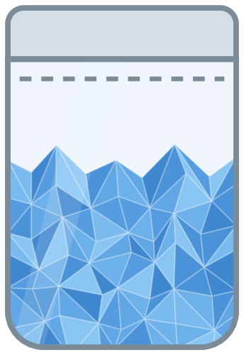
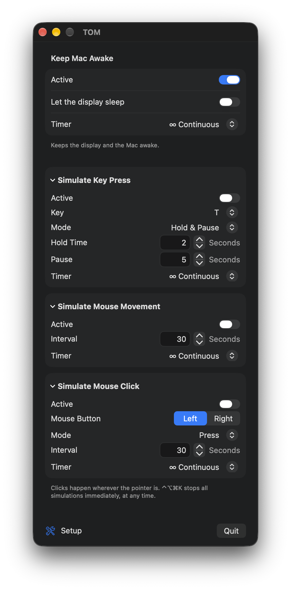
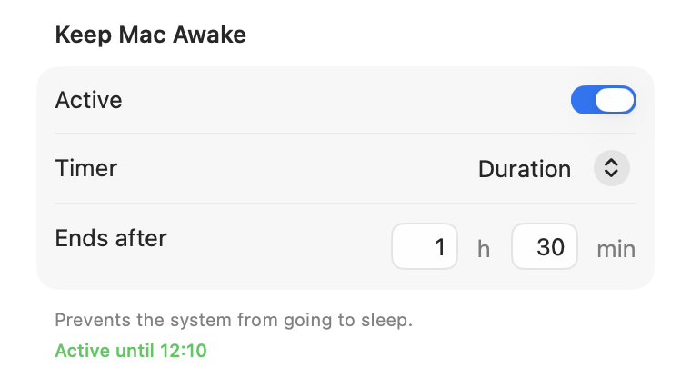
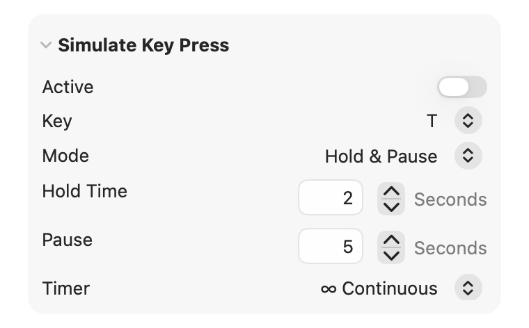
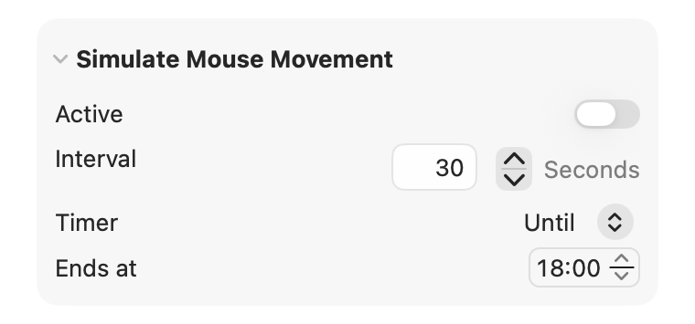
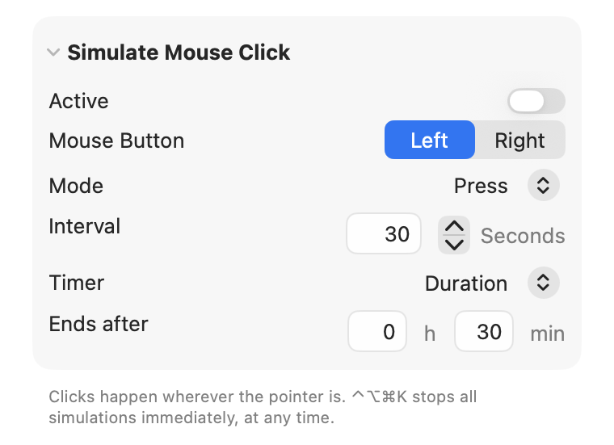
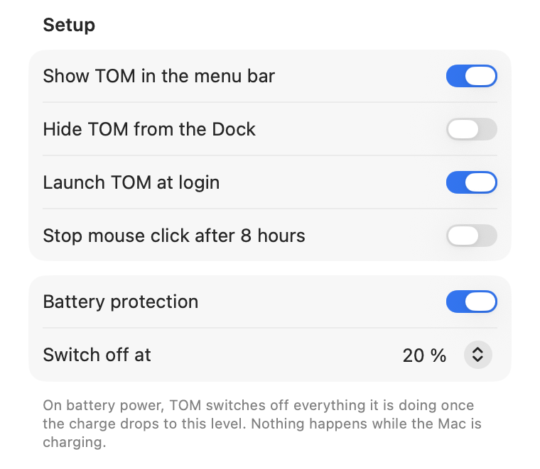

<h1 align="center">TOM – Tuco on Meth</h1>

<p align="center">
  
</p>

<p align="center">
  <b>Keep your Mac awake — and looking busy.</b><br>
  A small macOS utility with a window and an optional menu bar icon.<br>
  Free, open source, no account, no tracking.
</p>

<p align="center">
  
  
  
  
  
  <a href="../../releases/latest"></a>
</p>

<p align="center">
  <a href="../../releases/latest"></a>
  <a href="https://x.com/NeonRostDEV"></a>
</p>

<p align="center">
  <a href="#features">Features</a> ·
  <a href="#download">Download</a> ·
  <a href="#permissions">Permissions</a> ·
  <a href="#languages">Languages</a> ·
  <a href="#building">Building</a> ·
  <a href="#support">Support</a> ·
  <a href="https://neonrost.github.io/TOM/">Website</a> ·
  <a href="https://neonrost.github.io/TOM/TOM-Manual.pdf">Manual (PDF)</a>
</p>

<p align="center">
  
</p>

<table>
  <tr>
    <td width="25%" valign="top">
      <h3>🌙 Keeps it awake</h3>
      An IOKit power assertion stops the display and the system from sleeping. No permission needed.
    </td>
    <td width="25%" valign="top">
      <h3>⌨️ Press, hold, pause</h3>
      Key, mouse movement or mouse click: pressed at an interval, held down, or held and released in a loop.
    </td>
    <td width="25%" valign="top">
      <h3>⏱️ On a timer</h3>
      Every function runs continuously, for a set duration or until a time of day, then switches itself off.
    </td>
    <td width="25%" valign="top">
      <h3>🛡️ Safe by design</h3>
      <b>⌃⌥⌘K</b> stops everything instantly. Optional battery protection. Mouse functions never restart by themselves.
    </td>
  </tr>
</table>

<br>

## Features

Four independent functions, each in its own section you can fold in and out. Every screenshot here is the real app.

<table>
  <tr>
    <td width="50%" valign="top">
      <picture>
        <source media="(prefers-color-scheme: dark)" srcset="images/TOM_KeepAwake_dark.png">
        
      </picture>
      <br>
      <sub>Keep Mac Awake with a 90-minute timer; the end time is shown while it runs.</sub>
      <h3>Keep Mac Awake</h3>
      One switch stops the display and the system from going to sleep, regardless of your energy settings. It uses a power assertion, so it needs <b>no permission at all</b>.
      <br><br>
      Give it a timer and it switches itself off, after a set time or at a time of day.
    </td>
    <td width="50%" valign="top">
      <picture>
        <source media="(prefers-color-scheme: dark)" srcset="images/TOM_KeyPress_dark.png">
        
      </picture>
      <br>
      <sub>Hold &amp; Pause: the key is held for 2 seconds, released for 5, and so on.</sub>
      <h3>Simulate Key Press</h3>
      Sends a real key press via <code>CGEvent</code>. Pick any letter, number, arrow key, special key (Space, Return, Control …) or F13–F19; the labels follow your keyboard layout, QWERTZ and AZERTY included.
      <br><br>
      <b>Press</b> every 1–600 seconds, <b>Hold</b> until you switch it off, or <b>Hold &amp; Pause</b> in a loop. Starts after a 5-second countdown so you can bring the target window to the front.
    </td>
  </tr>
  <tr>
    <td width="50%" valign="top">
      <picture>
        <source media="(prefers-color-scheme: dark)" srcset="images/TOM_MouseMovement_dark.png">
        
      </picture>
      <br>
      <sub>Mouse movement every 30 seconds, until 18:00.</sub>
      <h3>Simulate Mouse Movement</h3>
      Nudges the pointer one pixel and immediately back at the interval you choose. No click, no visible jump, just enough for the system to see activity.
    </td>
    <td width="50%" valign="top">
      <picture>
        <source media="(prefers-color-scheme: dark)" srcset="images/TOM_MouseClick_dark.png">
        
      </picture>
      <br>
      <sub>Left clicks every 30 seconds for the next 30 minutes.</sub>
      <h3>Simulate Mouse Click</h3>
      Clicks or holds the left or right button wherever the pointer is: press as often as every 0.1 seconds, hold, or hold and pause. Starts after a 5-second countdown and runs as long as you set. An optional 8-hour limit lives in Setup.
    </td>
  </tr>
  <tr>
    <td width="50%" valign="top">
      <picture>
        <source media="(prefers-color-scheme: dark)" srcset="images/TOM_Setup_dark.png">
        
      </picture>
      <br>
      <sub>The Setup page, opened from the bottom left of the window.</sub>
      <h3>Setup</h3>
      Show TOM in the <b>menu bar</b> (its icon gets a green dot while anything is on), hide it from the <b>Dock</b>, <b>launch at login</b>, and an optional 8-hour mouse click limit.
      <br><br>
      <b>Battery protection:</b> on battery power, TOM switches everything off once the charge drops to a level you choose. Everything is off by default; changes apply with <i>Apply</i>.
    </td>
    <td width="50%" valign="top">
      <h3>Safe by design</h3>
      <b>⌃⌥⌘K</b> stops key press, mouse click and mouse movement immediately, from any app, and releases any key or button TOM is holding.
      <br><br>
      Mouse movement and mouse click are mutually exclusive, and their on/off states are deliberately <b>not restored on launch</b>: an app that starts clicking by itself after a restart would be dangerous. Quitting TOM releases anything it is holding down.
      <br><br>
      Settings and the folded state of each section are preserved across restarts.
    </td>
  </tr>
</table>

## Requirements

- macOS 13 (Ventura) or newer
- Apple Silicon (arm64)

## Download

Grab the latest build from the [Releases](../../releases) page — either the installer (`.dmg`: open it and drag TOM onto the Applications folder) or the `.zip` (unzip it and move `TOM.app` to your Applications folder).

The app is not notarized, so macOS will refuse to open it on first launch. Go to **System Settings → Privacy & Security**, scroll down to the message about TOM and click **Open Anyway**.

## Languages

The interface is available in **English**, **German** and **Spanish**, selected automatically from the system language. Unsupported languages fall back to English.

To try a language without changing your system settings, launch the binary directly:

```sh
TOM.app/Contents/MacOS/TOM -AppleLanguages '(es)'
```

## Permissions

- **Keep Mac Awake:** none.
- **Key press, mouse movement and mouse click:** require the **Accessibility** permission (System Settings → Privacy & Security → Accessibility). The app asks for it the first time you switch one of them on and links straight to the right pane. Note: after rebuilding with an ad-hoc signature, macOS treats the app as new, so the permission may have to be granted again (toggle the checkbox off and on).

The app is not sandboxed — required for `CGEvent` injection.

## Building

Requires Xcode 15 or newer.

The Xcode project is generated from `project.yml` with [XcodeGen](https://github.com/yonaskolb/XcodeGen), but the generated project is checked in as well:

```sh
open TOM.xcodeproj
```

Then build and run in Xcode (⌘R). After changing `project.yml`:

```sh
brew install xcodegen   # if not already installed
xcodegen generate
```

## Support

TOM is free and always will be. If it saved you some hassle, you can [buy me a coffee](https://ko-fi.com/neonrost).

## License

Copyright (C) 2026 NeonRost

This program is free software, released under the **GNU General Public License, version 3** (or, at your option, any later version). See the [LICENSE](LICENSE) file for details.
